<div align="center">



**A terminal whodunit where your AI assistant knows the answer and is insufferable about it.**


</div>

---

## 🕵️ The game

A murder has happened on a Hollywood set. You are the detective, and your assistant **Clarence** knows who did it. He just won't say it plainly.

Each round a hidden solution is picked at random from **20 suspects × 20 locations × 20 weapons**. You ask Clarence for clues and eliminate possibilities until you can accuse with confidence.

| Command | What it does |
|---|---|
| `clue` | Clarence gives you one clue, wrapped in sarcasm and long words |
| `accuse` | Name a suspect, a location and a weapon. Every guess narrows the remaining matrix |
| `exit` | Walk away from the case |

Clues are generated live by OpenAI's `gpt-3.5-turbo` from a prompt that gives Clarence the real answer and tells him to be smug but still useful.

---

## 🚀 Quick start

```bash
git clone https://github.com/aryankhanna1409/murdle.git
cd murdle/murdle

pip install -r requirements.txt
```

Create a `.env` file in the same folder with your own key:

```env
OPENAI_API_KEY=your-key-here
```

Then play:

```bash
python game.py
```

> The code uses the legacy `openai.ChatCompletion` API, so `requirements.txt` pins `openai<1.0`.

You can change `DIFFICULTY` (default `medium`) in `config.py` to adjust how generous Clarence's clues are.

---

## 📁 Project layout

| File | Role |
|---|---|
| `game.py` | Game loop, commands and accusation logic |
| `ai_assistant.py` | Builds Clarence's prompt and calls the OpenAI API |
| `data.py` | The suspects, locations and weapons |
| `config.py` | Loads the API key from `.env` and sets difficulty |

---

<div align="center">

Uses the ChatGPT API as-is, with no custom-trained model · just prompt design

</div>
